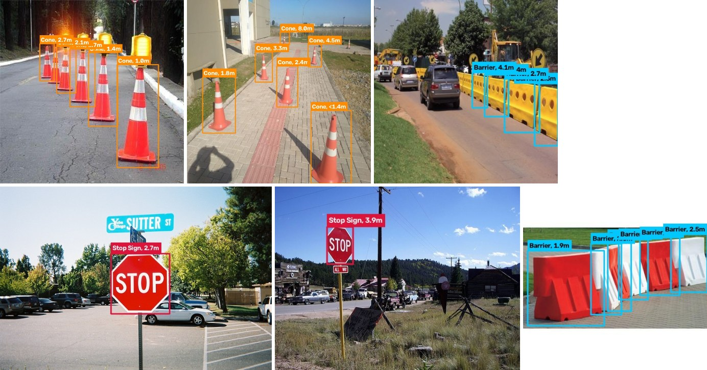
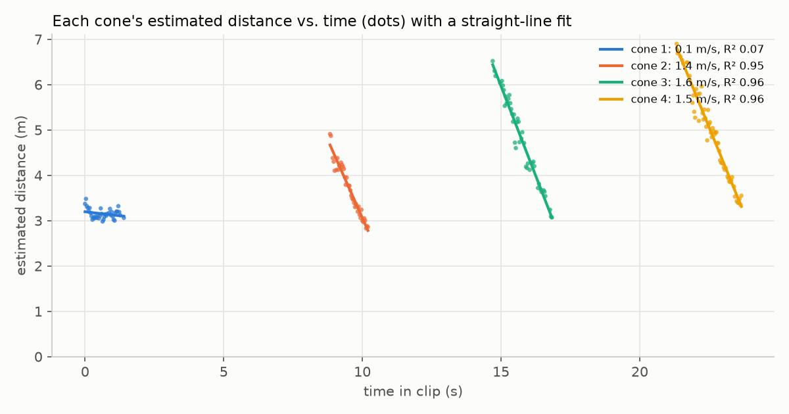
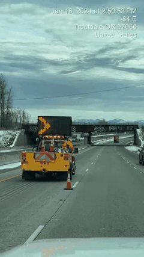
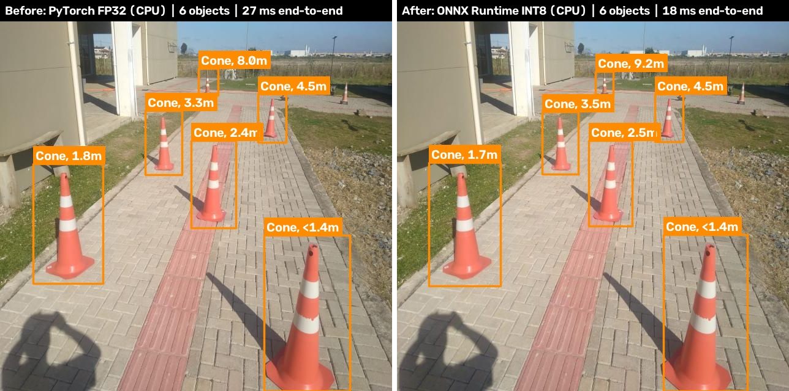
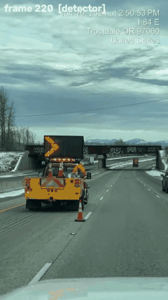

# Object Detection + Distance Estimation for Robotics Navigation

**Aadi Juthani**

A camera frame goes in, and the same frame comes out with every cone, barrier and
stop sign boxed and labeled with how far away it is, like `Cone, 1.5m` or
`Stop Sign, 3.2m`. Then the model is optimised for edge hardware, with
before/after numbers on CPU and GPU.



## Results at a glance

| Part | Result |
|---|---|
| Detection | Fine-tuned YOLO11n: **0.853 mAP@50** (0.607 mAP@50-95) on a held-out test set |
| Distance | Pinhole camera model from box height. On a real highway clip, each tracked cone's distance drops in a straight line (R² 0.95–0.97) |
| Edge optimization | CoreML FP16 on the Apple Neural Engine: **634 FPS** vs 163 FPS for the PyTorch GPU baseline, -0.009 mAP@50. INT8 is 3.2x smaller |
| Extra credit | Stereo disparity-to-depth derivation, optical-flow cone tracking |

## Running it

```bash
python -m venv .venv && source .venv/bin/activate
pip install -r requirements.txt

python scripts/run_demo.py --source path/to/image_folder_or_video   # uses the trained weights in outputs/weights
python -m pytest -q                                                 # distance math checks
```

To rebuild everything from scratch (the cone/barrier data needs a free Roboflow API key in `ROBOFLOW_API_KEY`):

```bash
python scripts/download_data.py
python scripts/prepare_dataset.py --roboflow data/raw/road_obstacle --coco data/raw
python scripts/train.py --epochs 40 --hours 1.5 --cache ram
python scripts/evaluate.py
python scripts/optimize.py --steps onnx int8 prune && python scripts/benchmark.py
```

Tested on an M4 MacBook Air with Python 3.13. The scripts pick `cuda`, `mps` or `cpu` on their own.
The CoreML export runs from its own small environment (`requirements-coreml.txt`), because
coremltools doesn't support the newest torch/NumPy yet.

The code is split so each piece can be swapped on its own: `navdet/` is the library (detection
pipeline, distance, drawing), `scripts/` are thin command-line wrappers around it, and `configs/`
holds the dataset and camera settings.

## 1. Object detection

**Data.** BDD100K doesn't label cones or barriers at all, and it folds stop signs into a generic
"traffic sign", so I combined two other sources into one 3-class dataset:

- **Cones and barriers:** [Roboflow Universe road-obstacle-detection](https://universe.roboflow.com/laasya-wdzur/road-obstacle-detection-6zwj5) (CC BY 4.0)
- **Stop signs:** the [COCO 2017](https://cocodataset.org) images that contain one

That's 4,380 images (3,736 train / 421 val / 223 test). The test split is never used in training,
and every number in this README is on it.

**Model.** YOLO11n, pretrained on COCO. The backbone already knows general shapes and textures,
so fine-tuning only has to teach it what cones and barriers look like (COCO already has stop
signs). It's also the smallest YOLO11 (2.6M parameters), which suits an edge robot. I trained it
for 1.5 hours on the M4's GPU (37 epochs). Validation mAP@50 was already 0.51 after the first
epoch, which is transfer learning doing its job.

| Class | Precision | Recall | mAP@50 | mAP@50-95 |
|---|---|---|---|---|
| cone | 0.833 | 0.731 | 0.803 | 0.450 |
| barrier | 0.803 | 0.850 | 0.900 | 0.651 |
| stop sign | 0.872 | 0.773 | 0.856 | 0.718 |
| **all** | **0.836** | **0.785** | **0.853** | **0.607** |

Training curves are in [outputs/metrics/training_curves.png](outputs/metrics/training_curves.png).

## 2. Distance estimation

Pinhole camera model, which is really just similar triangles. An object `H` meters tall at
distance `Z` shows up `h` pixels tall, so

```
Z = f_px * H_real / h_px
```

For example, with `f_px = 800`, a 0.7 m cone with a 373 px tall box is `800 * 0.7 / 373 = 1.5 m` away.
I use the box height rather than the width, because height barely changes when an object is turned at an angle.

The assumptions live in `configs/camera.yaml`:

- **Focal length:** no robot camera was given, so I assume a typical 65° horizontal field of view,
  `f_px = (W/2) / tan(HFOV/2)`. `scripts/calibrate_camera.py` replaces this with a real checkerboard calibration.
- **Object heights:** cone 0.70 m (standard 28"), stop sign 0.75 m (30" octagon), barrier 1.0 m.

Boxes cut off by the image edge get a `<` (e.g. `Cone, <1.4m`), since the object can only be closer
than that. Tiny boxes get `?m` instead of a made-up number.

**Does it work?** I don't have measured distances, so I used a video where the answer is predictable:
a car slowly driving toward cones on a highway
([Wikimedia Commons, CC BY 2.0](https://commons.wikimedia.org/wiki/File:Coning_off_the_traffic_lanes_on_I-84.webm)).
The cones don't move and the car's speed is roughly constant, so each cone's distance should fall in
a straight line, at the same rate for every cone.



Three cones give straight lines (R² 0.95–0.97) and nearly the same implied speed (1.4–1.6 m/s),
so the estimates are consistent from frame to frame and cone to cone. (Cone 1 is flat because the
car is barely moving at the start of the clip.) This doesn't prove the absolute scale, which still
rests on the assumed focal length and cone height.



## 3. Optimization for edge devices

I compared the baseline against three common edge tricks: half precision (FP16), 8-bit quantization
(INT8) and pruning. Everything was measured on the M4 MacBook Air: batch 1, 640×640 input, averaged
over 200 runs after warm-up, with mAP on the same test set for every row. "GPU" is the M4's GPU,
and CoreML can also run on Apple's Neural Engine.

| Variant | What changed | Size (MB) | CPU FPS | GPU FPS | Neural Engine FPS | mAP@50 | mAP@50-95 |
|---|---|---|---|---|---|---|---|
| **Baseline** (PyTorch) | nothing | 5.5* | 44.2 | 163.0 | – | 0.853 | 0.607 |
| **CoreML FP16** | half precision | 5.4 | 109.2 | 223.0 | **634.4** | 0.845 | 0.586 |
| **ONNX Runtime INT8** | 8-bit weights + activations | 3.3 | 71.3 | – | – | 0.824 | 0.576 |
| **Pruned 30%** | 30% of conv weights zeroed | 5.5* | 41.2 | 160.5 | – | 0.848 | 0.605 |

\* Ultralytics saves `.pt` files in half precision. The true FP32 size is 10.7 MB.

Before vs. after on the same image, both on the CPU: the same six cones, nearly the same distances,
27 ms → 18 ms end to end.



What I took from it:

- **FP16 was the clear winner.** On the Neural Engine it runs at 634 FPS, 3.9x the baseline's GPU speed,
  for -0.009 mAP@50. For a robot running on Apple silicon, this is the one to ship.
- **INT8 is the size win:** 3.2x smaller than FP32 and 1.6x faster on the CPU, for -0.029 mAP@50. Most
  of that speedup comes from ONNX Runtime itself, though (plain FP32 ONNX already gets 66 FPS), since
  the M4's CPU is very fast at float math. INT8 should matter more on a small ARM board.
- **Unstructured pruning doesn't make anything faster,** because the zeroed weights still get multiplied.
  It barely hurts accuracy, but a real speedup needs structured pruning (dropping whole channels) and
  a fine-tune afterwards.

## Extra credit

**Epipolar geometry.** For a rectified stereo pair with baseline `B`, the disparity is `d = fB/Z`,
so `Z = fB/d`. With stereo there's no need to guess object heights. The full derivation is in
[docs/epipolar_derivation.md](docs/epipolar_derivation.md).

**Optical flow.** `scripts/track_flow.py` runs the detector every 5th frame and tracks the cones in
between with Lucas-Kanade optical flow. The detector takes 14.7 ms per frame and the flow update
0.1 ms, so 4 out of 5 frames cost about 1% as much.



## Limitations

- **Domain shift.** Most training cones are close-up product photos, so on the highway video it misses
  some mid-distance cones and sometimes calls a red tail light a stop sign. A per-class threshold
  (`--class-conf stop_sign=0.6`) helps, but adding real driving frames to training would be the proper fix.
- **Distances rest on two guesses:** the focal length and each object's real height. Calibrating the
  actual camera removes the first one, and stereo or a depth sensor removes both.
- **Only measured on Apple silicon.** I'd like the same table on a Jetson (TensorRT) and a
  Raspberry Pi-class CPU.

## Credits

Roboflow road-obstacle-detection by laasya-wdzur (CC BY 4.0), COCO 2017, the I-84 video from
Wikimedia Commons (CC BY 2.0, demo only), and YOLO11 by Ultralytics (AGPL-3.0).

## Contact

- **Name:** Aadi Juthani
- **Phone:** +1 4703824008
- **Email:** aadijuthani@gatech.edu
